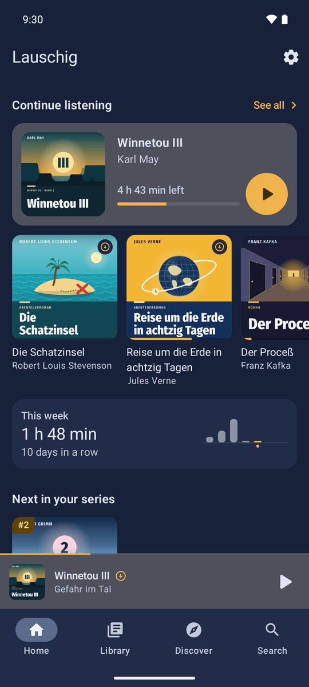
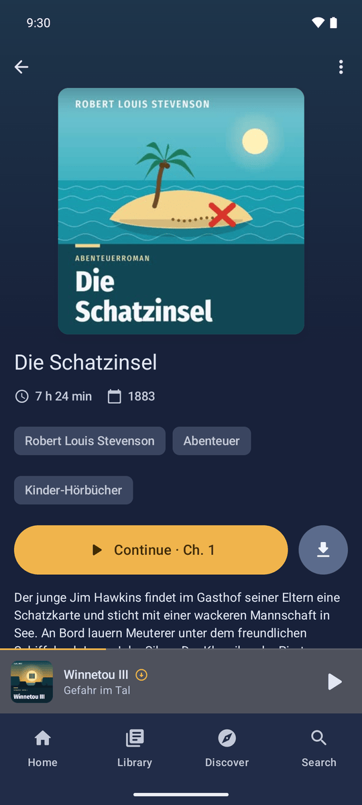
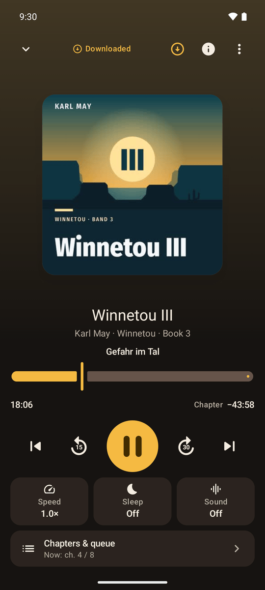
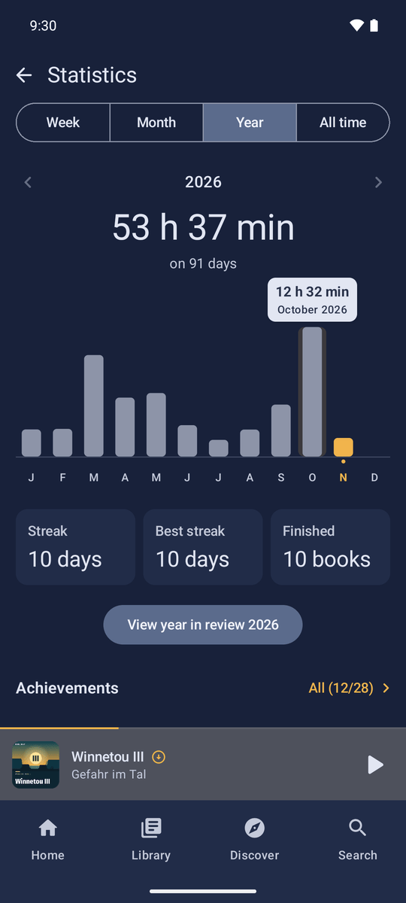
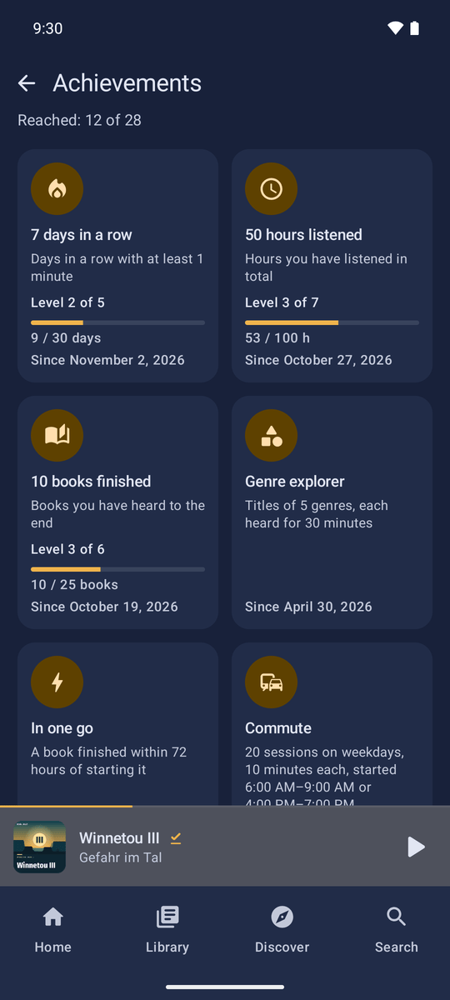
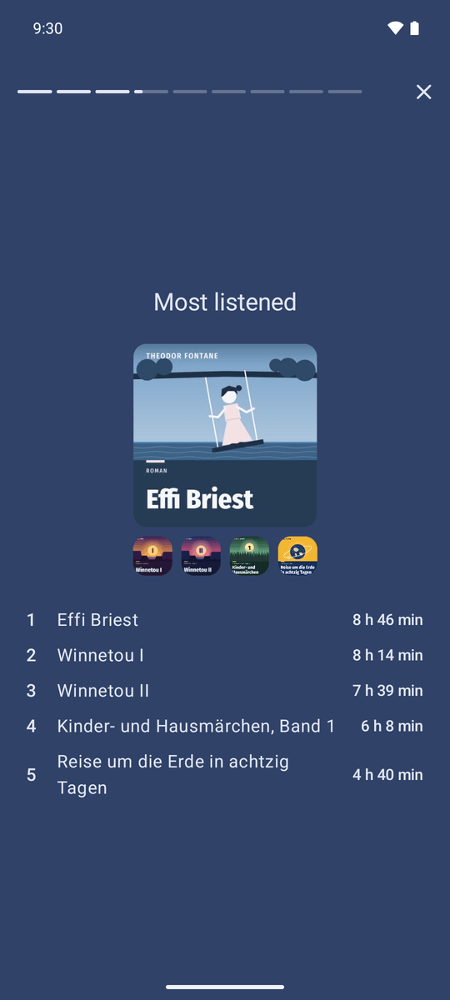
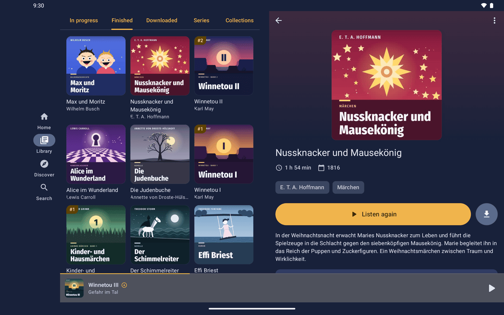

# Lauschig

Lauschig is a native, offline-first Android client for [Audiobookshelf](https://www.audiobookshelf.org/).
It is built for listening: your library and downloaded books open instantly, playback never waits for the
network, and listening progress is synced with the server whenever a connection is available.

## Screenshots

<table>
  <tr>
    <td align="center" valign="top"><br>Continue where you left off</td>
    <td align="center" valign="top"><br>Everything about a title at a glance</td>
    <td align="center" valign="top"><br>Player in the warm Fireside tone</td>
  </tr>
  <tr>
    <td align="center" valign="top"><br>Listening statistics by week, month and year</td>
    <td align="center" valign="top"><br>Achievements for streaks, hours and finished books</td>
    <td align="center" valign="top"><br>Your year in review</td>
  </tr>
</table>



On tablets, the library and a title's details sit side by side.

The screenshots use a demo library of public-domain books with covers made for it.

## Why

Existing clients tend to block on the server at startup or lose progress when offline. Lauschig treats the
local database as the source of truth and uses the network only in the background.

## Status

Version 0.4.0, in daily use on our own devices; not on Google Play yet (a closed test is planned). What works:

- Offline first: library, downloads, progress and listening sessions live on the device and sync in the background.
- Browsing by series, authors, narrators, genres, tags and collections; podcasts; search; single sign-on (OIDC).
- Player with chapters, per-title speed and volume boost, sleep timer, bookmarks, listening history and a queue;
  books and folders that exist only on the device.
- Android Auto, voice search, a home-screen widget, links from the Audiobookshelf web app, phone and tablet layouts.
- Listening statistics, achievements and a year in review, computed on the device.
- New in 0.4.0 (Phase 6): adjustable skip steps, a new player layout, a hint tone (chime) before the sleep timer fades
  out, night compression, a warm night palette ("Fireside"), chapter search, faster search and library, and a cover
  cache.
- Downloads on an SD card, optional automatic deletion of heard downloads (per account, off by default), and a
  diagnostic log you can share – with passwords, tokens and server addresses masked.

The design spec and the phase plans (mostly German) live in [`docs/superpowers/specs/`](docs/superpowers/specs/) and [`docs/superpowers/plans/`](docs/superpowers/plans/).

## Tech

Kotlin, Jetpack Compose, Hilt, Room, Media3, WorkManager. Android 9+ (minSdk 28).

Modules: `:app` (UI, playback, sync, downloads), `:core:database` (Room entities, DAOs and the exported schemas),
`:core:model` (plain Kotlin keys every layer shares) and `:abs-api` (the Audiobookshelf API).

## Build

```sh
./gradlew :app:assembleDebug testDebugUnitTest :abs-api:test :core:model:test lint
```

## Release build

```sh
./gradlew :app:bundleRelease
```

Signing is read from the environment (or Gradle properties): `LAUSCHIG_KEYSTORE`, `LAUSCHIG_KEYSTORE_PASSWORD`,
`LAUSCHIG_KEY_ALIAS`, `LAUSCHIG_KEY_PASSWORD`. Without them the bundle is built **unsigned** and a warning is printed.
Never commit a keystore. Pushing a tag `v*` runs `.github/workflows/release.yml`, which builds the signed AAB from
repository secrets (`LAUSCHIG_KEYSTORE_BASE64` plus the three values above); uploading to Play is manual. CI uses environment variables only (no Gradle properties files).

## Baseline profile and startup benchmark

The `:baselineprofile` module needs a connected physical device (USB debugging on, ideally the phone you use):

```sh
# Generate and apply the baseline profile (writes app/src/release/generated/baselineProfiles/)
./gradlew :app:generateBaselineProfile

# Macrobenchmark: cold start offline (target < 800 ms, recorded, never fails the run).
# Sign in and sync once, then switch the phone to airplane mode and run:
./gradlew :baselineprofile:connectedBenchmarkAndroidTest \
  -Pandroid.testInstrumentationRunnerArguments.class=io.wolftown.lauschig.baselineprofile.StartupBenchmark
```

Journeys (startup, library scroll) live in `baselineprofile/src/main/kotlin/`. Compile check without a device:
`./gradlew :baselineprofile:assemble`.

## License

GPL-3.0-or-later. See [LICENSE](LICENSE).
